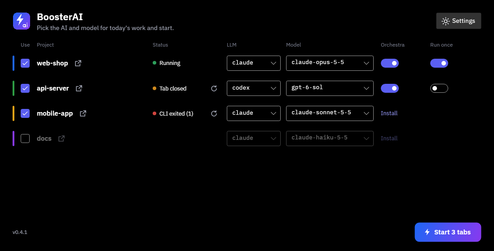
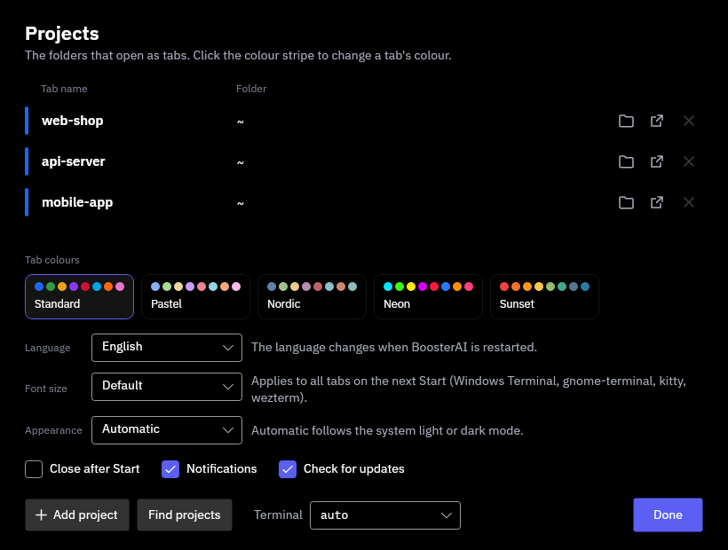

<p align="center"></p>

# BoosterAI

Start your whole working day with one click: BoosterAI opens every project you work on as a terminal tab with an AI coding CLI (`claude`, `codex` or `agy`) already running, and you pick the model per tab to match the tokens you have left.

**[Download the latest release](https://github.com/solwation/booster-ai/releases/latest)** for Windows or Linux. See [Install](#install).



## Features

- **One click, many tabs.** Each project opens in its own tab, in the right directory, with its own colour and title.
- **Model per tab.** Include or skip a project, pick `claude`, `codex`, `agy` or a plain shell, and pick a model from the list or type any model id.
- **Remembered between runs.** Your choices are saved, so the next start is usually one click.
- **Status per tab.** Running, exited, not found or closed, with a restart button; the window minimizes to the taskbar (plus a tray icon on Windows).
- **Notifications.** A system notification when a tab closes, fails to start or its CLI exits with an error.
- **Orchestra on demand.** For projects that use [Dirigenten och orkestern](https://github.com/solwation/dirigenten-och-orkestern), a toggle sends `/orkester` as the first prompt, and projects without it get a one-click install.
- **Run the orchestra once.** A per-project toggle runs `/orkester` non-interactively and leaves you a normal shell with the result; the restart button then runs it again.
- **Find your projects.** *Find projects* searches Documents (or any folder you pick) for git checkouts and folders with an AI instruction file (`AGENTS.md`, `CLAUDE.md`, `AI.md` …) and adds the ones you tick.
- **Open the folder.** One button per project opens its directory in Explorer (WSL folders included), Finder or your Linux file manager.
- **Your shell, your setup.** Tabs run through `bash -lic`, so your aliases and `PATH` apply, and you keep a normal shell when the CLI exits.
- **Font size.** One setting zooms the CLI text in all tabs.
- **Themes and language.** Five tab colour themes, an Appearance setting (Auto, Light or Dark, applied at once), in Swedish or English.
- **Stays up to date.** At start and once a day BoosterAI asks GitHub for a newer release and offers it in a quiet bar: *Update* downloads it, checks it against `SHA256SUMS` and restarts into the new version; *Later* or *Skip this version* (turn the check off in Settings).
- **Windows and Linux.** Windows Terminal with WSL on Windows; Ptyxis, gnome-terminal, konsole, xfce4-terminal, kitty, wezterm or xterm on Linux.



## Install

Download the latest build from [Releases](https://github.com/solwation/booster-ai/releases/latest). Builds are self-contained single files, so the target machine needs no .NET. Check the download against `SHA256SUMS` if you like (`sha256sum -c SHA256SUMS --ignore-missing`).

Linux: extract `BoosterAI-<version>-linux-x64.tar.gz` and run the installer inside it. It installs to `~/.local/bin` and adds a menu entry:

```sh
tar -xzf BoosterAI-<version>-linux-x64.tar.gz
BoosterAI-<version>-linux-x64/install-linux.sh
```

Windows: extract `BoosterAI-<version>-win-x64.zip` and run the installer inside it. It adds Start menu and desktop shortcuts, no admin rights needed:

```powershell
powershell -ExecutionPolicy Bypass -File install-windows.ps1
```

You also need at least one of the CLIs you want to start (`claude`, `codex` or `agy`) installed where the tabs run, and on Windows a WSL distribution.

## More

- [Details](docs/DETAILS.md): how it works per platform, settings and config file, font size, language, the orchestra toggle, how tab monitoring works and how updates are installed.
- [Development](docs/DEVELOPMENT.md): build from source, tests, UI strings, screenshots, icon and releases.

## Contributing

Development is issue-driven and run with the orchestra itself: issues are picked by priority and delivered by worker agents. Read [AGENTS.md](AGENTS.md) and [.orchestra/project.md](.orchestra/project.md) before you start. Open an issue to propose a change.

## License

[MIT](LICENSE)
