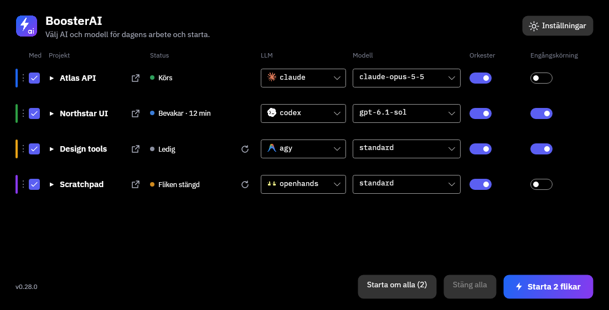

<p align="center"></p>

# BoosterAI

Start your whole working day with one click: BoosterAI opens every project you work on as a dedicated terminal tab with an AI coding CLI (`claude`, `codex`, `agy`, `aider`, or `openhands`) already running. Pick models per tab to balance your token budget, inspect live agent output without switching windows, and automate your daily multi-agent workflow on Windows and Linux.

🌐 **Website & Interactive Previews:** **[solwation.github.io/booster-ai](https://solwation.github.io/booster-ai/)**  
📦 **Download:** **[Latest Release (Windows & Linux)](https://github.com/solwation/booster-ai/releases/latest)**



## Highlights

- **One click, all your workspaces:** Opens each repository in its own color-coded tab in the right directory. Add subtabs sharing a folder for multi-agent workflows.
- **Granular model control:** Run Opus or Pro on architecture tasks and Flash or Haiku on routine fixes. Switch models in-place without losing the ongoing conversation.
- **Live Peek:** Hover any tab's status badge to stream its last 20 terminal output lines live &mdash; never break focus to check if an agent is done.
- **Orchestra on demand:** Native integration with [Dirigenten och orkestern](https://github.com/solwation/dirigenten-och-orkestern) for unattended autonomous queue execution.
- **WSL memory guard:** Live RAM telemetry, 30-minute min/avg/max tracking, and memory cap tuning directly in Settings.
- **Graceful end-of-day close:** *Close all* asks running agents to commit, push, and cleanly terminate background processes.

*For an interactive walkthrough and detailed feature guides, visit the [BoosterAI website](https://solwation.github.io/booster-ai/).*

## Quick Install

Download the self-contained archive from [Releases](https://github.com/solwation/booster-ai/releases/latest) (no .NET runtime required):

### Windows 11 (PowerShell)
Extract `BoosterAI-*-win-x64.zip` and run the installer (no admin rights needed):
```powershell
powershell -ExecutionPolicy Bypass -File install-windows.ps1
```
> **Note:** Windows SmartScreen may show an unrecognized app warning while our open-source code signing verification is underway. Click **More info** &rarr; **Run anyway**.

### Linux (Bash)
Extract `BoosterAI-*-linux-x64.tar.gz` and run the installer:
```sh
tar -xzf BoosterAI-*-linux-x64.tar.gz
BoosterAI-*-linux-x64/install-linux.sh
```

## Documentation & More

- **[Website](https://solwation.github.io/booster-ai/)**: Features overview, screenshots, and visual tour.
- **[Details](docs/DETAILS.md)**: Deep dive into platform architecture, settings, configuration, tab recovery, and background updating.
- **[Development](docs/DEVELOPMENT.md)**: Building from source, testing, headless screenshot rendering, and release process.
- **[Contributing](AGENTS.md)**: Issue workflow, orchestra coordination, and development guidelines.

## License

[MIT](LICENSE)
