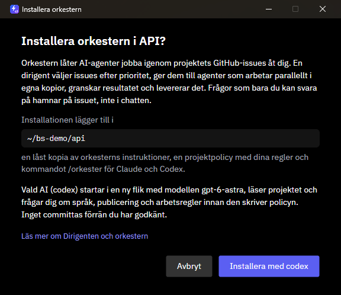
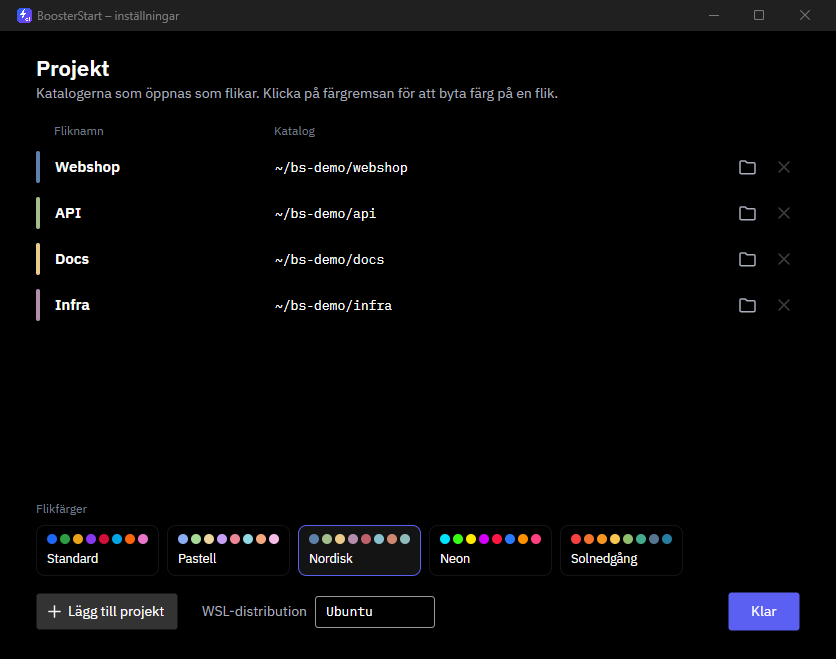
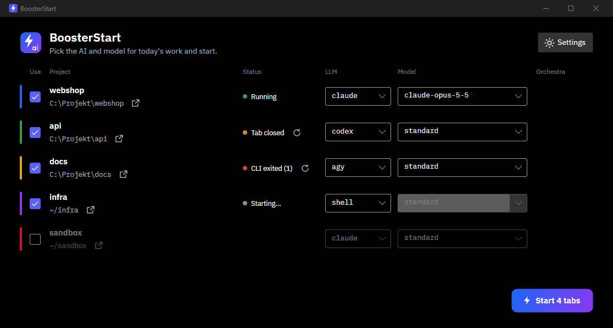
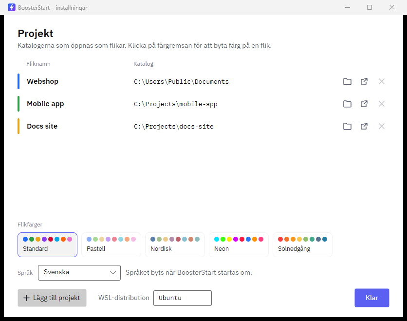
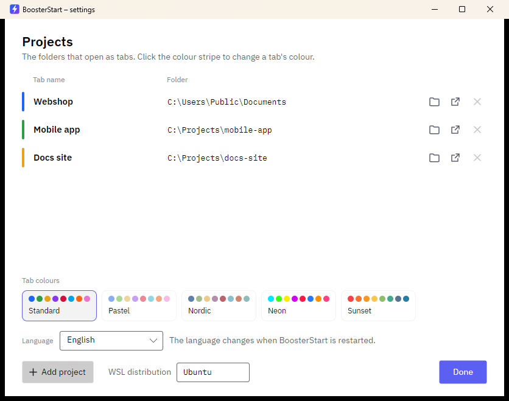
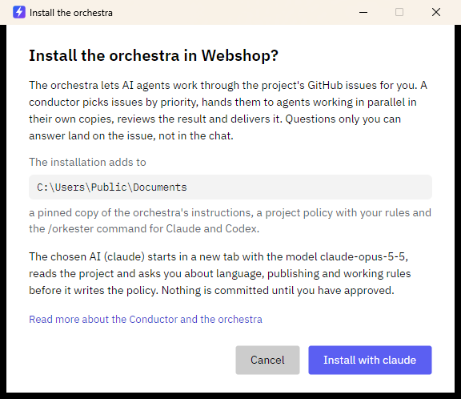

<p align="center"></p>

# BoosterAI

Start your whole working day with one click. BoosterAI opens every project you work on as a terminal tab, each with an AI coding CLI (`claude`, `codex` or `agy`) already running in it. You pick the model per tab, so you can match each day's tasks to the tokens you have left.


BoosterAI is a small desktop app for Windows and Linux, built with Avalonia on .NET 10. The interface is available in Swedish and English (see [Language](#language)).

## Why

If you work in several repositories with AI coding tools, the morning routine is the same every day: open a terminal, change directory, start the CLI, choose a model, repeat for each project. Some days you want the strongest model everywhere; on others, with tokens running low, a cheaper model for routine work and the best one only where it counts. BoosterAI keeps that choice in one window and does the rest for you.

## Features

- **One click, many tabs.** Every project you include opens in its own tab, in the right directory, with its own colour and title.
- **Per-tab choices each day.** Include the project or skip it, pick the LLM (`claude`, `codex`, `agy`, or a plain shell), pick the model from a list or type any model id. "Standard" uses the CLI's own default.
- **Remembered between runs.** Your choices are saved, so the next start is usually one click.
- **Orchestra on demand.** For projects that use [Dirigenten och orkestern](https://github.com/solwation/dirigenten-och-orkestern), a toggle sends `/orkester` as the first prompt. See below.
- **Open the folder.** A button next to each project opens its directory in Explorer (WSL folders included), Finder or your Linux file manager.
- **Your shell, your setup.** Each tab runs the CLI through `bash -lic`, so your aliases and `PATH` apply. When the CLI exits, you keep a normal shell in the tab.
- **Themes.** Five tab colour themes: Standard, Pastell, Nordisk, Neon and Solnedgång.

### The orchestra toggle

[Dirigenten och orkestern](https://github.com/solwation/dirigenten-och-orkestern) lets AI agents work through a project's GitHub issues. A conductor picks issues by priority, hands them to parallel worker agents in their own checkouts, then reviews and delivers the results.

The toggle appears only for projects that have it installed. Other projects show an "Installera" link: a dialog explains what will happen, then the AI you chose opens in a new tab and installs it, asking you about the rules before it commits anything.



## Settings

The settings window holds your projects (name and directory, with a folder picker), the tab colour theme, and where tabs run. On Windows you point at your normal Windows folders; WSL shares (`\\wsl.localhost\...`) and Linux paths such as `~/webshop` work too. Whether an agent then works in a mirror elsewhere is up to your own agent instructions.

**Font size.** *Font size* in the settings window zooms the CLI text in all tabs (80–200 %; saved as `"ZoomPercent"` in `config.json`, `0` = the terminal's default, which changes nothing). It applies on the next Start. On Windows, BoosterAI writes `%LOCALAPPDATA%\Microsoft\Windows Terminal\Fragments\BoosterAI\boosterai.json` (a hidden "BoosterAI" profile that only sets `font.size`, as a percentage of Windows Terminal's 12 pt default, and inherits your other defaults) and opens the tabs with `-p BoosterAI`; at the default size the file is removed. Windows Terminal reads fragments when it starts, so a new or changed size applies once every Windows Terminal window has been closed and reopened (until then the tabs open at your default size). Your own `settings.json` is never touched. On Linux the zoom is passed to gnome-terminal (`--zoom`), kitty (`-o font_size`, 11 pt base) and wezterm (`--config font_size`, 12 pt base); other terminals (konsole, xfce4-terminal, xterm, ...) have no command-line option for it and ignore the setting. `BoosterAI --dry-run` prints the resulting commands and fragment.



## Language

BoosterAI speaks Swedish and English. By default it follows the operating system's UI language (Swedish if that is Swedish, otherwise English). Choose **Automatiskt / Svenska / English** under *Language* in the settings window; the choice is saved in `config.json` (`"Language": "auto" | "sv" | "en"`) and **takes effect after BoosterAI is restarted**. The prompt sent to the AI when it installs the orchestra follows the chosen language too.

| | Swedish | English |
| --- | --- | --- |
| Start window |  |  |
| Settings |  |  |
| Install dialog |  |  |

To add a string for development: add the same key to both `src/BoosterAI/Resources/Strings.sv.json` and `Strings.en.json` (a test fails if they differ), then use `{local:T some.key}` in XAML or `Loc.Get("some.key")` / `Loc.Format("some.key", args)` in code.

## How it works per platform

| | Terminal | Where tabs run |
|---|---|---|
| Windows | Windows Terminal (`wt.exe`), one tab per project with colour and title | The WSL distribution you choose (default `Ubuntu`), in your Windows folder (`C:\…` opens as `/mnt/c/…`) |
| Linux | `gnome-terminal`, `konsole`, `xfce4-terminal`, `kitty`, `wezterm` or `xterm` (chosen or auto-detected) | Locally |

Settings are stored in `%APPDATA%\BoosterAI\config.json` on Windows and `~/.config/BoosterAI/config.json` on Linux. A project entry is just a name and a directory, for example `C:\Projects\webshop` or `~/webshop`.

`BoosterAI --dry-run` prints the commands that Start would run, without opening anything.
The app follows the system's light or dark theme; `--theme light` or `--theme dark` overrides it.

## Watching the tabs

After **Start**, BoosterAI stays running and shows a status per tab: *Starting…*, *Running*, *CLI exited (code)*, *CLI not found*, *Did not start*, *Tab closed* or *Lost*. On Windows the window goes to the system tray, and clicking the icon brings it back. On Linux it minimizes instead, because many desktops (plain GNOME, for example) have no tray. A tab that has closed or whose CLI has exited gets a restart button. The button opens the tab again with the same AI, model and orchestra choice, in the same Windows Terminal window.

When something unexpected happens (a tab closes, does not start, or its CLI exits with an error), BoosterAI shows a system notification. On Windows this is a toast. On Linux it uses `notify-send` when that is installed. In *Settings* you can turn **Notifications** off, and you can choose **Close after Start** to get the old behaviour back.

How it works: each Start creates a session folder (`%LOCALAPPDATA%\BoosterAI\sessions\…` on Windows, which WSL writes to through `/mnt/c`, or `~/.local/share/BoosterAI/sessions/…` on Linux) containing a small `tab-lib.sh`. Each tab's shell sources that script, and it appends `start` (PID and start time), `cli-start`, `cli-exit rc=N` and `exit` to the tab's log. The CLI still runs in the tab's own interactive login shell, so `~/.bashrc` aliases still apply, and closing the tab still ends the CLI. The app polls the logs every 2 seconds. A shell that is gone without logging `exit` (for example after `wsl --shutdown`) counts as *Lost*. Windows detects this through `\\wsl.localhost\<distro>\proc`. Session folders older than two days are removed.

Known limit: when you close a Windows Terminal window that holds several tabs, WSL may keep their shells alive for up to about a minute, so *Tab closed* can appear late.

`--screenshot` shows sample statuses and opens the window without taking focus (used for the images above).

## Install

Download the latest build from [Releases](https://github.com/solwation/booster-ai/releases/latest). Builds are self-contained single files, so the target machine needs no .NET. Check the download against `SHA256SUMS` if you like (`sha256sum -c SHA256SUMS --ignore-missing`).

Linux: extract `BoosterAI-<version>-linux-x64.tar.gz` and run the installer inside it. It installs to `~/.local/bin` and adds a menu entry:

```sh
tar -xzf BoosterAI-<version>-linux-x64.tar.gz
BoosterAI-<version>-linux-x64/install-linux.sh
```

Windows: extract `BoosterAI-<version>-win-x64.zip` and run the installer inside it. It adds Start menu and desktop shortcuts, no admin rights needed:

```powershell
powershell -ExecutionPolicy Bypass -File install-windows.ps1
```

You also need at least one of the CLIs you want to start (`claude`, `codex` or `agy`) installed where the tabs run, and on Windows a WSL distribution.

Alternatively, build from source (below) and run `tools/install-linux.sh` or `tools\install-windows.ps1` from the checkout.

## Build from source

You need the .NET 10 SDK.

```sh
tools/publish.sh    # dist/win-x64/BoosterAI.exe and dist/linux-x64/BoosterAI
tools/install-linux.sh   # or tools\\install-windows.ps1, see Install
```

The app icon is drawn in `assets/boosterai.svg` (with a bolt-only variant for 16–24 px in
`assets/boosterai-small.svg`). After editing either, regenerate the PNG and the multi-size ICO:

```sh
dotnet run --project tools/IconRender
```

Run the tests with:

```sh
dotnet test tests/BoosterAI.Tests
```

## Contributing

Development is issue-driven and run with the orchestra itself: issues are picked by priority and delivered by worker agents. Read [AGENTS.md](AGENTS.md) and [.orchestra/project.md](.orchestra/project.md) before you start. Open an issue to propose a change.

## License

[MIT](LICENSE)
