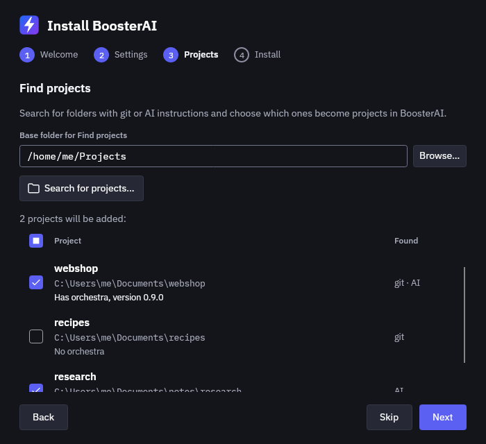

<p align="center"></p>

# BoosterAI

Start your whole working day with one click: BoosterAI opens every project you work on as a dedicated terminal tab with an AI coding CLI (`claude`, `codex`, `agy`, `aider`, `interpreter`, or `openhands`) already running. Pick models per tab to balance your token budget, inspect live agent output without switching windows, and automate your daily multi-agent workflow on Windows and Linux.

🌐 **Website & Interactive Previews:** **[solwation.github.io/booster-ai](https://solwation.github.io/booster-ai/)**  
📦 **Download:** **[Latest Release (Windows & Linux)](https://github.com/solwation/booster-ai/releases/latest)**


## Highlights

- **One click, all your workspaces:** Opens each repository in its own color-coded tab in the right directory. Add subtabs sharing a folder for multi-agent workflows.
- **Granular model control:** Run Opus or Pro on architecture tasks and Flash or Haiku on routine fixes. Switch models in-place without losing the ongoing conversation.
- **Agent overview:** Recognize each CLI by its icon; manage installation, permissions and context in separate settings sections.
- **Context budgets:** Choose Off, Auto or Manual under Optimization; tune or reset individual agents in Manual. Auto uses known model capacity and an explained task reserve. [How budgets work](docs/DETAILS.md#auto-compaction-budgets).
- **Live Peek:** Hover any tab's status badge, or focus it and press Enter/Space, to stream its last 20 terminal output lines live &mdash; never break focus to check if an agent is done.
- **Orchestra on demand:** Native integration with [Dirigenten och orkestern](https://github.com/solwation/dirigenten-och-orkestern) for unattended autonomous queue execution. Reload an idle Claude orchestra in its existing conversation without restarting its tab.
- **WSL memory guard:** Live RAM telemetry, 30-minute min/avg/max tracking, and memory cap tuning directly in Settings.
- **Graceful end-of-day close:** *Close all* asks running agents to commit, push, and cleanly terminate background processes.

*For an interactive walkthrough and detailed feature guides, visit the [BoosterAI website](https://solwation.github.io/booster-ai/).*

## Quick Install

Download from [Releases](https://github.com/solwation/booster-ai/releases/latest); everything is self-contained (no .NET runtime required).

### Windows 11

1. Download `BoosterAI-Setup-<version>-win-x64.exe` from the [latest release](https://github.com/solwation/booster-ai/releases/latest) and run it. No administrator rights are needed.
2. Choose your language, appearance and the AI CLI for newly found projects. In *Find projects*, choose a base folder to search and select the projects to add. You can skip either step to keep your current settings or projects.
3. Click *Install*. BoosterAI installs for your user in `%LOCALAPPDATA%\Programs\BoosterAI`, creates Start menu and desktop shortcuts, then starts in the background. Use *Open BoosterAI* on the finish page to open its window.

<details>
<summary>Preview the setup guide's project search</summary>



</details>

**Upgrading:** run a newer setup directly; there is no need to uninstall first. Existing projects and settings are kept unless you choose to change or add them in the guide. **Uninstalling:** remove BoosterAI through Windows Settings → Apps → Installed apps. Your configuration and projects are kept for a later reinstall.

For scripted or IT deployment, see [Setup mode](docs/DEVELOPMENT.md#setup-mode-windows) for silent `--quiet` installation and uninstallation.

Alternatively, extract `BoosterAI-*-win-x64.zip` and run the installer script in PowerShell:
```powershell
powershell -ExecutionPolicy Bypass -File install-windows.ps1
```
> **Code signing:** Windows releases are signed by **Svep Design Center AB**. SmartScreen can still warn about a new release while it builds reputation; check the publisher before choosing **More info** &rarr; **Run anyway**.

### Linux (Bash)
Extract `BoosterAI-*-linux-x64.tar.gz` and run the installer:
```sh
tar -xzf BoosterAI-*-linux-x64.tar.gz
BoosterAI-*-linux-x64/install-linux.sh
```

## Documentation & More

- **[Website](https://solwation.github.io/booster-ai/)**: Features overview, screenshots, and visual tour.
- **[Details](docs/DETAILS.md)**: Deep dive into platform architecture, settings, configuration, tab recovery, and background updating.
- **[Development](docs/DEVELOPMENT.md)**: Building from source, testing, headless screenshot rendering, and release process.
- **[Contributing](AGENTS.md)**: Issue workflow, orchestra coordination, and development guidelines.

## License

[MIT](LICENSE)
