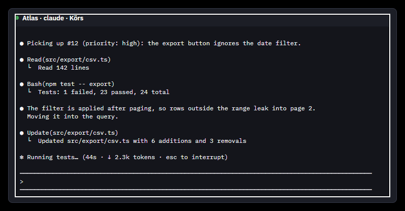
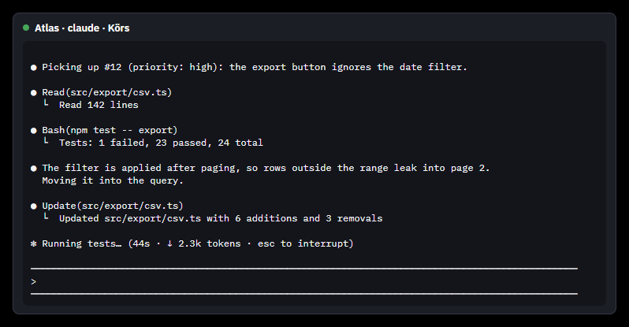
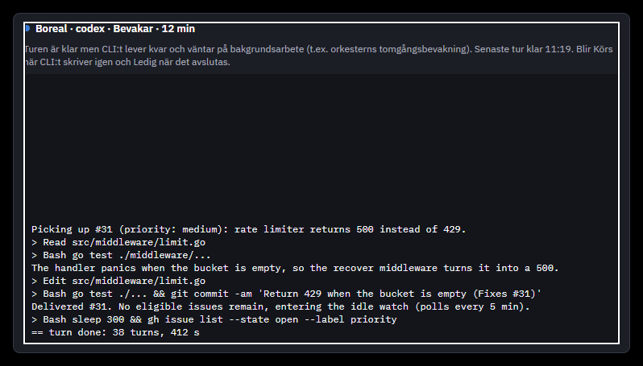
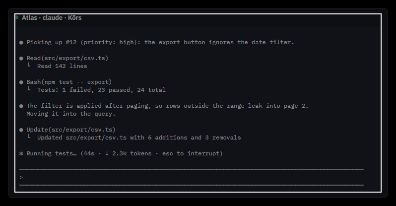
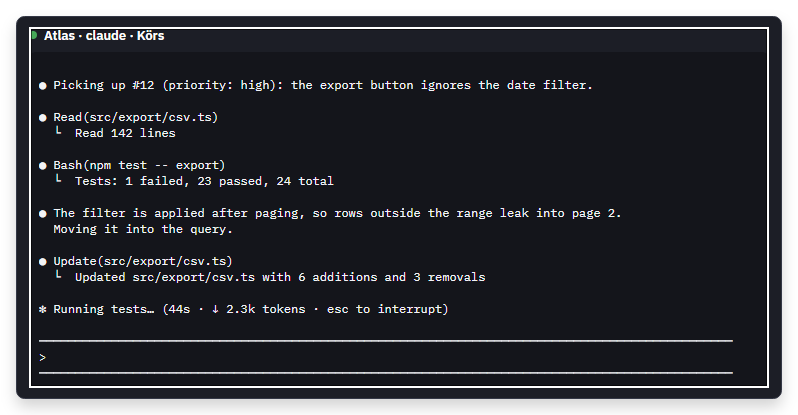

# Native Windows Live Peek verification (#154)

Verified on 2026-11-11 using the real `App`, `MainWindow`, `StatusPeekView` and
`TabOutputView` from application revision `d14abfa`. Its application sources and
assets are identical to the released `v0.37.0` (`git diff d14abfa v0.37.0 -- src assets`
is empty). The local assembly's default version is 0.36.0; release publishing supplies
0.37.0 as an MSBuild property. [Input identity](input.json) records the assembly hash.

This run uses Avalonia's native Win32 platform, separate popup HWNDs and the Windows
composition renderer, rather than the headless screenshot renderer. A second run
uses the native Win32 software fallback. The images below were inspected manually.

## Desktop isolation

The controller creates a uniquely named private Windows desktop, starts each child
with `STARTUPINFO.lpDesktop`, and never calls `SwitchDesktop`. It polls the original
desktop's foreground HWND every 25 ms while each child runs and checks it again at
the end. [The controller result](controller.json) confirms that the foreground window
remained unchanged and both children exited successfully. All child processes are
waited for, or killed as a process tree in `finally` on timeout; desktop/process
handles are closed. A final process check found zero `NativePeek` processes.

Only the invented Atlas/Boreal sample configuration and built-in sample output are
used. The existing screenshot-active guard disables normal startup probes, update
checks, terminal discovery and setup work; it does not select the headless platform
or change the view's resources or popup implementation. No personal config, terminal,
CLI, installation or desktop screenshot is accessed.

## Opacity and rendering evidence

- [Default renderer](default/native.json): `Avalonia.Win32.PopupImpl`, a separate
  HWND and `WinUiCompositedWindowSurface`. All visual ancestors of the popup surface
  have opacity 1 and the surface brush is opaque `#FF1C1E26`.
- [Default-renderer pixel check](default/opacity.json): all 300 samples in a clean
  interior padding strip exactly match the surface colour. Temporarily setting the
  surface opacity to 0.5 changes all 300 samples to the half-intensity colour. After
  restoring opacity 1, all 300 samples match again. The negative control proves that
  the native capture detects translucency rather than merely producing a fixed image.
- [Software renderer](software/native.json) and [its pixel check](software/opacity.json):
  the real HWND's premultiplied BGRA framebuffer has alpha 255 in all 300 samples,
  alpha 127 at opacity 0.5, and alpha 255 again after restoration. This independently
  preserves alpha, which the `PrintWindow` RGB capture alone cannot prove.
- The outer native popup is allowed to be transparent for rounded corners and shadow.
  The interior surface and output background are opaque; the two should not be confused.
- The pointer preview and keyboard-opened details were both captured. The running
  and watching headers contain the status dot, project, agent and state. The output
  glyphs render without missing-character boxes.











## Reproduction

The small [harness](harness/NativePeek.csproj) is verification tooling, not part of the
application or its normal test suite. Its reflection helpers are pinned to Avalonia
11.3.22. From the repository root on Windows:

```powershell
dotnet build src/BoosterAI -c Release
$verifyBin = Join-Path $env:TEMP 'BoosterAI-Peek-bin'
$verifyEvidence = Join-Path $env:TEMP 'BoosterAI-Peek-evidence'
dotnet publish docs/verification/154/native-windows/harness/NativePeek.csproj -c Release -r win-x64 --self-contained false -o $verifyBin
& (Join-Path $verifyBin 'NativePeek.exe') --controller $verifyEvidence
```

An existing application build can be supplied with `-p:BoosterAssembly=<absolute DLL
path>` at publish time. The harness writes neutral config, images and JSON only into
its evidence directory. Review `controller.json`, each `opacity.json`, the child exit
codes and the images; a captured image alone is not the opacity test.

Limits: this is one Windows host and its native composition/software paths, using
neutral sample output rather than a live agent session. It does not measure every
graphics driver or change the installed application. The missing native Windows
verification from the original completion is now performed and documented.
