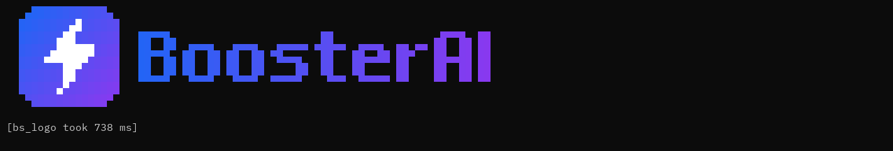
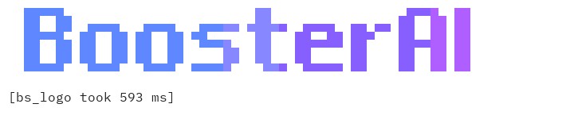
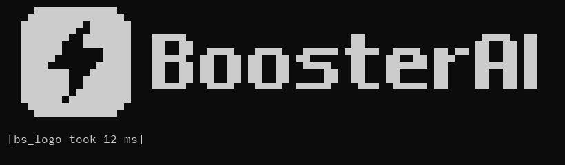
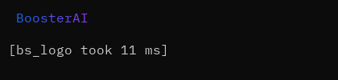
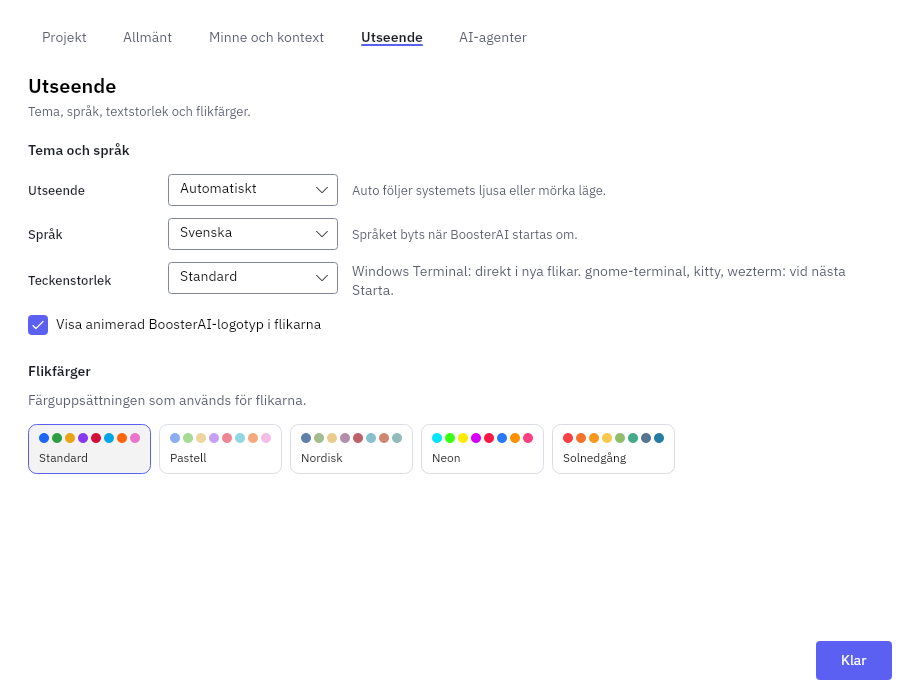
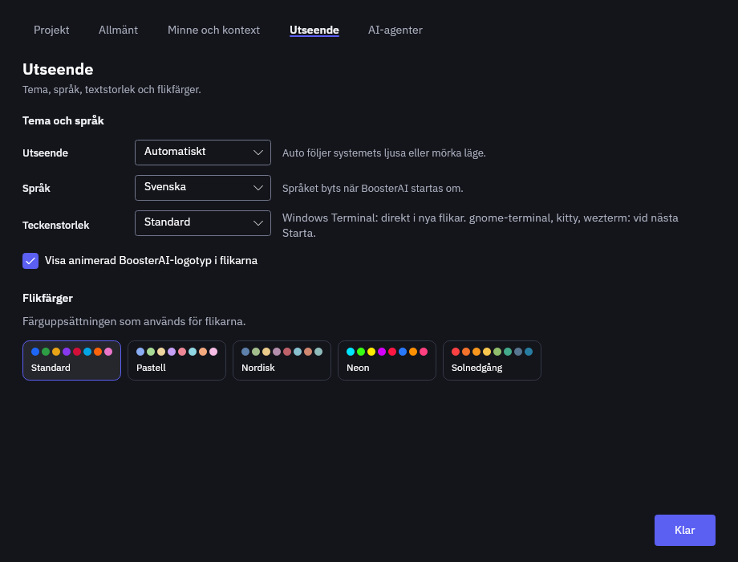

# #242 verification: animated BoosterAI logo in every tab

Verified on olw-win10 (WSL Ubuntu + Windows 11) on the delivered revision.

- `dotnet build src/BoosterAI -c Release`: 0 warnings, 0 errors. `dotnet test tests/BoosterAI.Tests` (WSL): 1584 passed, 0 failed. `TabLogoTests` cover the art, which scripts include `bs_logo` (start, continue, restart, install prompt, shell tabs; not Run once or the resume fallback's fresh start), the `ShowTabLogo` setting, size thresholds, colour detection, no TTY, and real-terminal runs (cursor restored, in-place redraw, duration).
- `BoosterAI --dry-run`: `(bs_logo 2>/dev/null || true)` after `bs_reset` in interactive and restart scripts, absent from Run once.
- Windows Terminal: [CommandCheck](CommandCheck/Program.cs) opened the real tracked `Launcher.TabScript` (with this session's `tab-lib.sh`) in one named portable Windows Terminal 1.24.12741.0 window on a private desktop, with a fake `claude` first on `PATH`. A wrapper recorded the real `bs_logo` decision: TTY, colour depth 24 (`WT_SESSION` reaches WSL), 120×30, full variant, 655 ms, exit 0; the CLI then started with `CLAUDE_CODE_ENABLE_AWAY_SUMMARY=0`. Result: [windows-command.json](windows-command.json).
- Logo frames, rendered from captured terminal output with a small ANSI-to-PNG renderer (not terminal screenshots):     
- Settings (headless `--screenshot --window settings --tab utseende`, neutral config):  
- Not verified: how the animation looks to the eye in a visible Windows Terminal or Linux terminal window (the check ran on a hidden desktop to avoid stealing focus).
