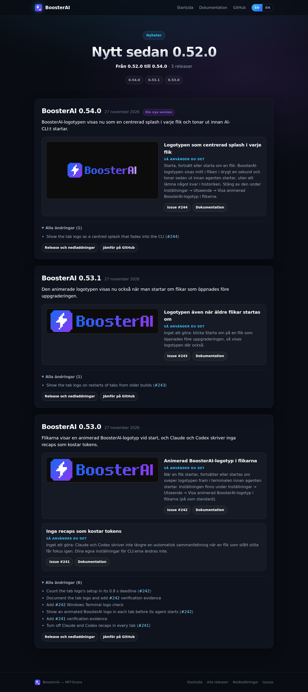
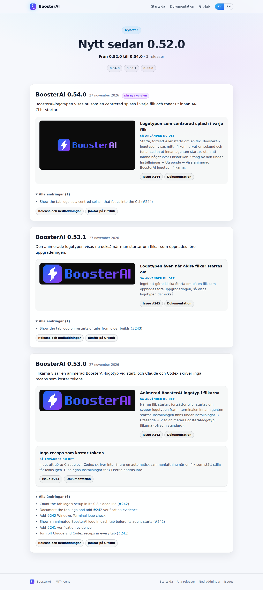
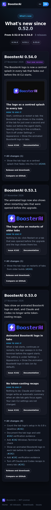
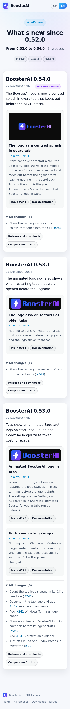
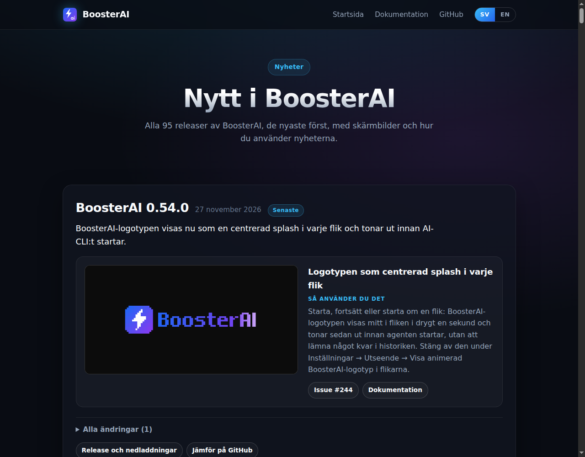
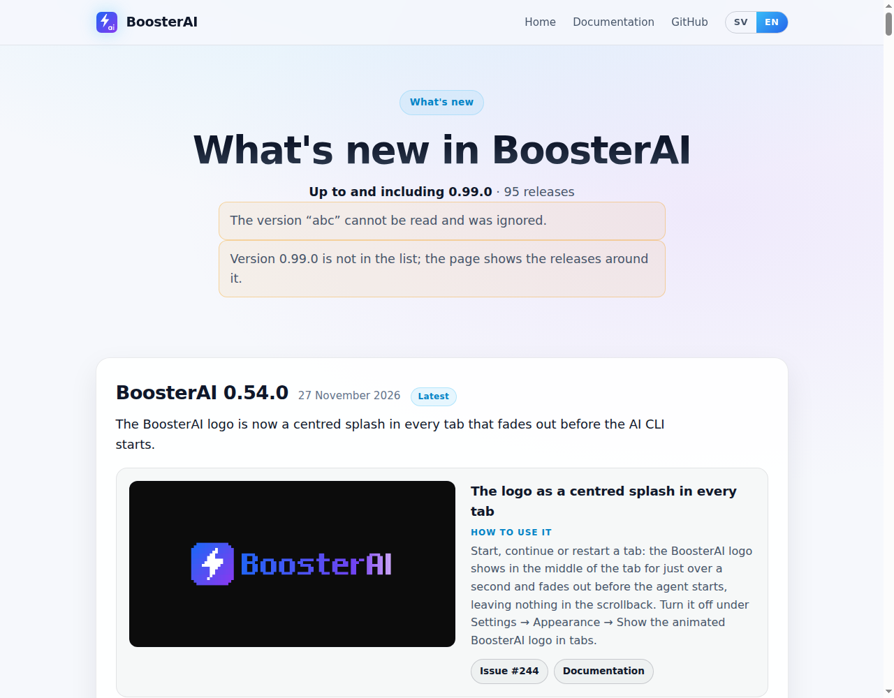

# #245 verification: release page on GitHub Pages

Verified in WSL Ubuntu on the delivered revision.

- `dotnet build src/BoosterAI -c Release`: 0 warnings, 0 errors. `dotnet test tests/BoosterAI.Tests`: 1598 passed, 0 failed. New `UpdateTests` cover the link (`from` = running version, `to` = offered release, several skipped releases, unknown 0.0.0 versions and a backwards range left out, `lang=sv|en`), the link without a newer release (what is new since the version updated from) and `NoteRun` (records `LastRunVersion`/`UpdatedFromVersion`, a downgrade clears it); `VersionLinkTests` checks the bottom-left version link; `ConfigMergeTests` covers the two new settings.
- `tools/release-page.py rebuild`: 95 final releases from the tags; `check v0.54.0` passes; a simulated `v0.55.0` summary with a `feature:` block (per-language image) gives the expected entry, `check` fails clearly for a missing release and skips pre-releases. `tools/release-notes.sh v0.54.0` now ends with the release-page link.
- Page rendered with headless Chromium 155 through the DevTools protocol (emulated `prefers-color-scheme`, served by a local static server), `?from=0.52.0&to=0.54.0` lists 0.54.0, 0.53.1 and 0.53.0 (0.52.0 excluded), no horizontal overflow at 390 px, all images loaded:
  - Swedish, dark, 1280 px: 
  - Swedish, light, 1280 px: 
  - English, dark, 390 px: 
  - English, light, 390 px: 
  - No parameters (all 95 releases, top of the page): 
  - `?from=abc&to=0.99.0`: notices for the unreadable and the unknown version: 
  - `?from=0.54.0&to=0.54.0`: shows that one release with a notice: 
- The update bar does not change visibly (only the target of *Show more* and the version link, and the accessible name), so no new app screenshot.
- Not verified: the page on the live GitHub Pages site (it goes live when `main` is pushed) and the GitHub API fallback against the live API (it only runs when `releases.json` is missing or older than `to`).
