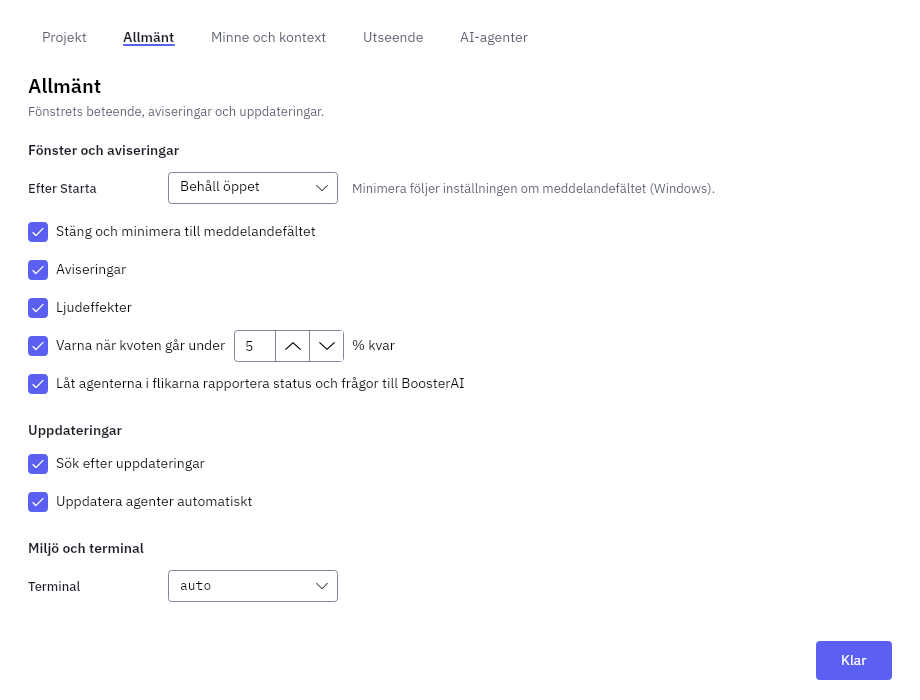
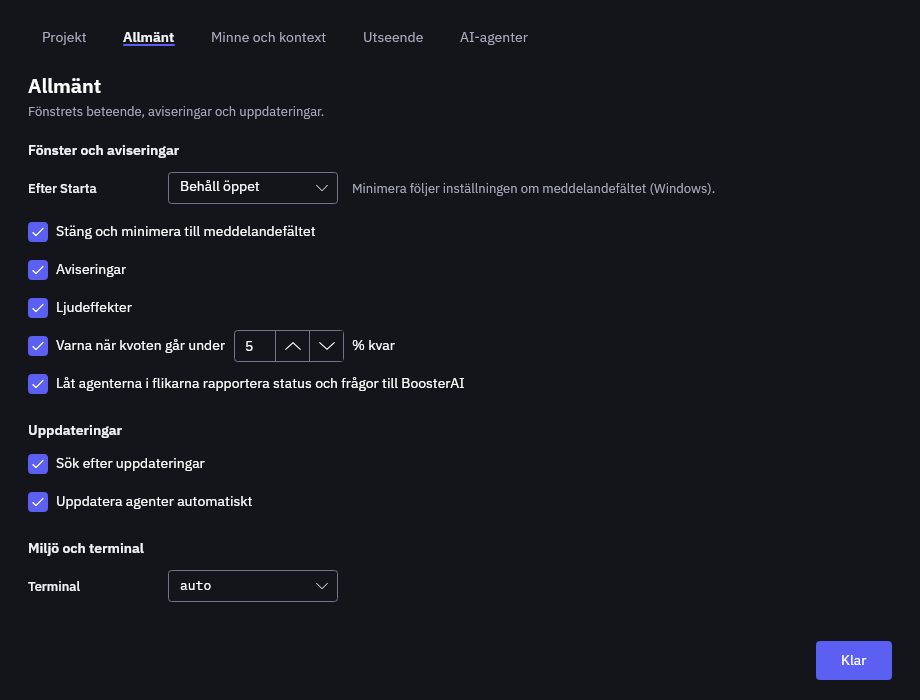
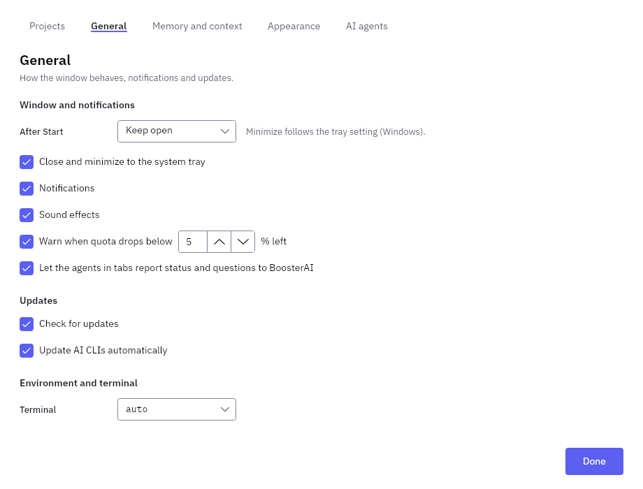
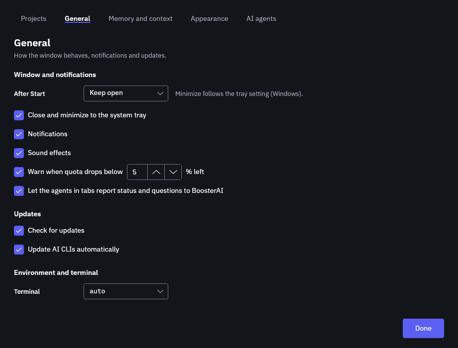

# #247 verification: per-tab status channel foundation

Verified in WSL (Ubuntu, .NET 10) on the worker checkout, before integration.

- `dotnet build src/BoosterAI -c Release`: 0 warnings, 0 errors. `dotnet test tests/BoosterAI.Tests`: 1603 passed, 0 failed (one earlier full run hit a timing-sensitive `TabLogoTests` splash case and once `HooksStaySilentAndSucceedWhenTheLogCannotBeWritten` under load; both pass alone and in the rerun of the full suite, and neither touches this change).
- `TabChannelTests` (14): valid status and question events; broken, unversioned, newer-version, unknown and half-written lines skipped; events before the latest `cli-start` ignored; text/option caps; only the last 1 MiB of an oversize file read from a whole line; reading while the agent appends; answering writes one complete file (no temporary left), a second answer and 16 concurrent answers have exactly one winner; a dead writer's lock is taken over; a question id reused after an in-place restart is open again and answerable; unsafe ids rejected; `TabStatusChannel` on by default and saved; with it off no channel file exists, no variables are defined and the tab script is unchanged. `ConfigMergeTests` covers the setting's round-trip between instances.
- `BoosterAI --dry-run` (neutral config): the only difference between `TabStatusChannel` on and off is the one summary line (`tab status channel (#247, protocol v1): …` vs `tab status channel: off`); every tab script is identical.
- Settings → Allmänt/General (headless `--screenshot --window settings --tab general`, neutral config):
     
- Not part of this issue: the agent's side (MCP server, `boosterai-tab` command, exporting the variables into the tab, CLI registration, #248) and showing status/questions in the main window (#249). Windows-side `dotnet test` from the mirror runs at integration.
