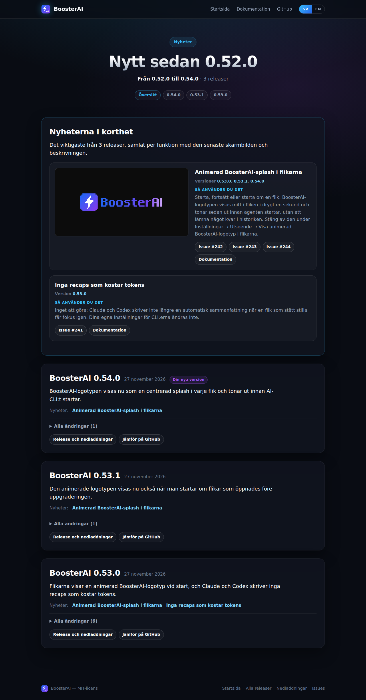
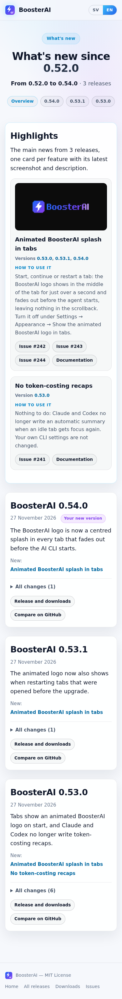
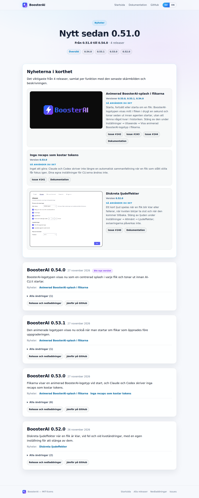
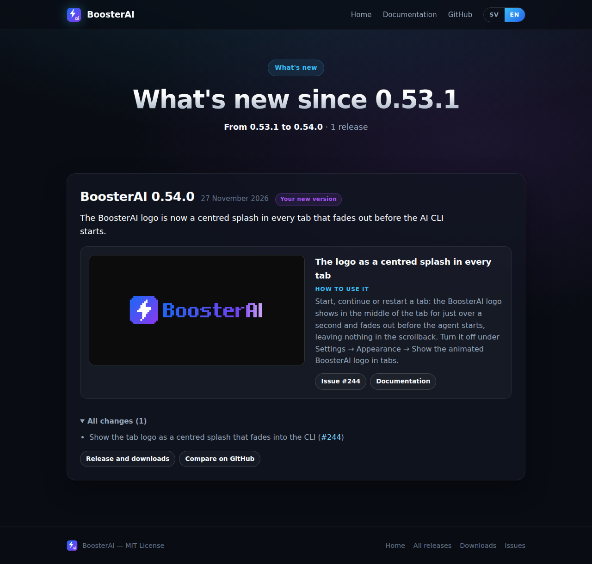

# #250 verification: one card per topic on the release page

Verified in WSL Ubuntu; no C# changed, so no dotnet build/test.

- `tools/release-page.py check v0.54.0`: passes ("v0.54.0 is current"). `tools/release-page.py rebuild` reproduces `docs/releases.json` byte for byte (the topics survive). A simulated `v0.55.0` summary gives `topic`/`topicTitle` from `topic:`/`topictitle.sv|en:`, a feature without `topic:` inherits the topic of its issue from the JSON (#244 → `tab-splash`), and an invalid id (`Bad Topic`) fails clearly.
- Data: #242 (0.53.0), #243 (0.53.1) and #244 (0.54.0) have `topic: tab-splash`; #244 carries the merged heading "Animerad BoosterAI-splash i flikarna" / "Animated BoosterAI splash in tabs". #241 and #240 have no topic and stay their own cards.
- Page rendered with headless Chromium (Playwright build 1248) through the DevTools protocol, as for #245 (emulated `prefers-color-scheme`, local static server); all images loaded, no horizontal overflow at 390 px:
  - `?from=0.52.0&to=0.54.0`, Swedish, dark, 1280 px: overview first with the merged splash card (latest screenshot and how-to, issues #242 #243 #244, versions 0.53.0, 0.53.1, 0.54.0) on top, then #241; each release below links its cards and keeps its commit list collapsed: 
  - Same range, English, light, 390 px: 
  - `?from=0.51.0&to=0.54.0`, Swedish, light, 1280 px (includes 0.52.0, so #240 shows as its own card): 
  - `?from=0.53.1&to=0.54.0` (one release), English, dark: its own feature card with its own title and the open commit list, as before: 
  - No parameters (all 95 releases): renders without errors (overview + 95 sections), not saved.
- Not verified: the live GitHub Pages site (goes live when `main` is pushed).
